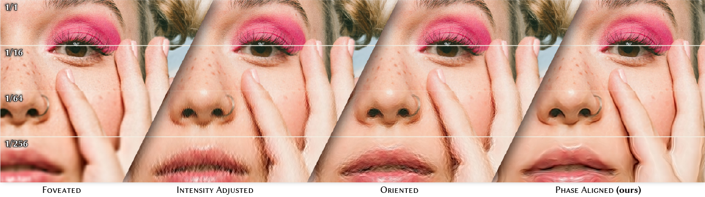

# Phase-Aligned Metamers



Code and data for the paper **It's Not Just a Phase: Creating Phase-Aligned Peripheral Metamers** (SIGGRAPH Conference Papers '26, [doi:10.1145/3799902.3811056](https://doi.org/10.1145/3799902.3811056)).

Phase-aligned enhancement for foveated images. Detail lost through foveation (blur in the periphery) is replaced by a synthesized enhancement signal whose local orientation, phase and intensity follow the image's statistics, extrapolated from coarser scales.

**Project website:** [sophie-kergassner.github.io/phase-aligned-metamers](https://sophie-kergassner.github.io/phase-aligned-metamers.html). Try the interactive real-time WebGPU viewer there, and find more information: an explanatory video, the paper and other material.

## Contents

| Folder | Contents | Details |
|---|---|---|
| [`python/`](python/) | Python/PyTorch reference implementation, with a step-by-step walkthrough in [`example.ipynb`](python/example.ipynb) | [`python/README.md`](python/README.md) |
| [`web/`](web/) | Real-time WebGPU version: the full pipeline on the GPU in the browser, updating live as you move your gaze | [`web/README.md`](web/README.md) |
| [`dataset/`](dataset/) | Results of the paper's perceptual study: detection rates, thresholds, viewing geometry | [`dataset/README.md`](dataset/README.md) |
| [`fixes/`](fixes/) | Corrections found after the paper; on by default, each can be switched off to reproduce the paper | [`fixes/README.md`](fixes/README.md) |
| [`images/`](images/) | Example scenes, shared by all implementations | [`images/README.md`](images/README.md) (sources and licenses) |

Each folder's README lists its own requirements.

## Python Reference Implementation

[`python/`](python/) contains the package `phase_aligned_metamers` (viewing geometry, foveation, pyramids, analysis, repair, synthesis of the enhancement signal, composition). Install `torch`, `torchvision`, `numpy`, `scipy`, `matplotlib` and `pillow`, then open [`python/example.ipynb`](python/example.ipynb) and run all cells. It processes `images/face.jpg` step by step, shows the intermediate results and renders the experiments. See [`python/README.md`](python/README.md) for the pipeline, experiments and conventions.

## Real-Time WebGPU Version

[`web/`](web/) runs the full pipeline in real time in the browser with WebGPU. The same code runs on the [project page](https://sophie-kergassner.github.io/phase-aligned-metamers.html), so you can try it there without installing anything. JavaScript ([`main.js`](web/main.js)) sets up the GPU passes. The pipeline steps themselves are compute shaders written in WGSL, the WebGPU Shading Language, in [`web/shaders/`](web/shaders/). The Python package is the reference: [`web/test_webgpu.py`](web/test_webgpu.py) checks every shader against it.

To run it locally, serve the repository root over HTTP (`python -m http.server 8000`) and open <http://localhost:8000/web/> in a current Chrome, Edge or Safari. See [`web/README.md`](web/README.md) for details.

## User Study Dataset

[`dataset/`](dataset/) contains the results of the paper's perceptual study: for every stimulus image and eccentricity, how often 11 observers could tell it apart from the full-resolution reference (with confidence intervals), the 75 % thresholds per method, and the exact viewing geometry. [`dataset/plots.ipynb`](dataset/plots.ipynb) plots all of it (needs `numpy`, `pandas`, `matplotlib`). The full-resolution stimulus images are archived separately on [Zenodo](https://doi.org/10.5281/zenodo.24483038) (see [`dataset/README.md`](dataset/README.md)).

## Post-Project Fixes

[`fixes/`](fixes/) documents two corrections found after the project was finished (phase sign alignment at ±90°, orientation smoothing). The results in the paper do not include them. They are on by default in the code and the web demo, and each can be switched off to reproduce the paper's behaviour; see [`fixes/README.md`](fixes/README.md).

## Citation

If you use this code or data, please cite our paper:

```bibtex
@inproceedings{kergassner-2026,
  author = {Kerga\ss{}ner, Sophie and Didyk, Piotr},
  title = {It’s Not Just a Phase: Creating Phase-Aligned Peripheral Metamers},
  year = {2026},
  publisher = {ACM},
  doi = {10.1145/3799902.3811056},
  booktitle = {Proc. Special Interest Group on Computer Graphics and Interactive Techniques Conference Conference Papers},
  articleno = {143},
  numpages = {11},
  series = {SIGGRAPH Conference Papers '26}
}
```

## License

The code is released under the [MIT License](LICENSE). The study data in `dataset/` is under [CC BY 4.0](https://creativecommons.org/licenses/by/4.0/) (see [`dataset/README.md`](dataset/README.md)). The images (`images/`, `teaser.jpg`) are excluded: they are third-party works under their own licenses, listed in [images/README.md](images/README.md).
